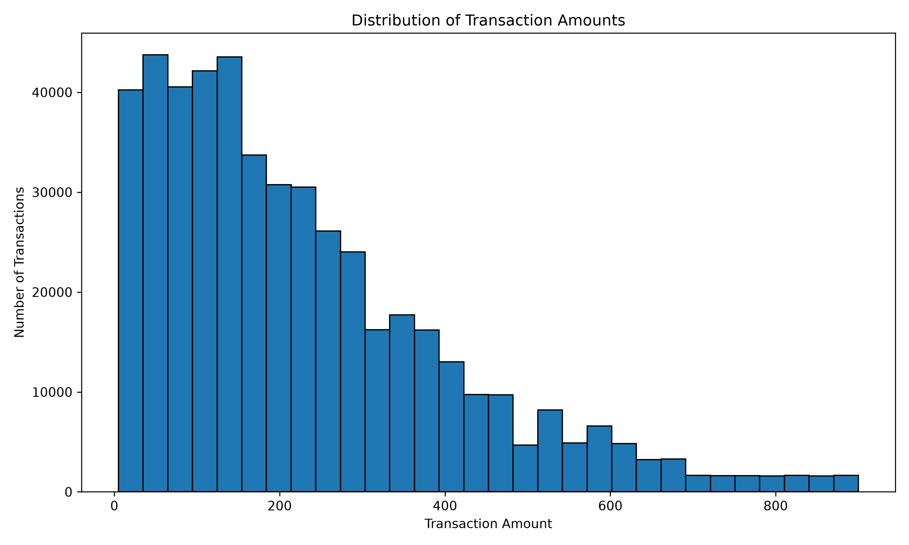
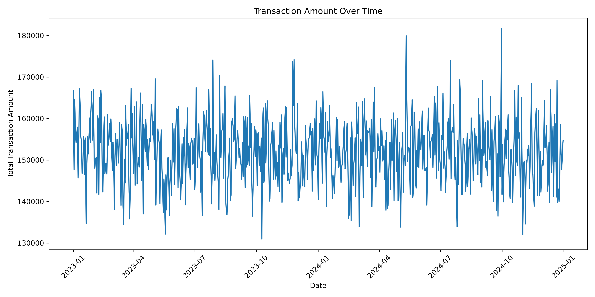
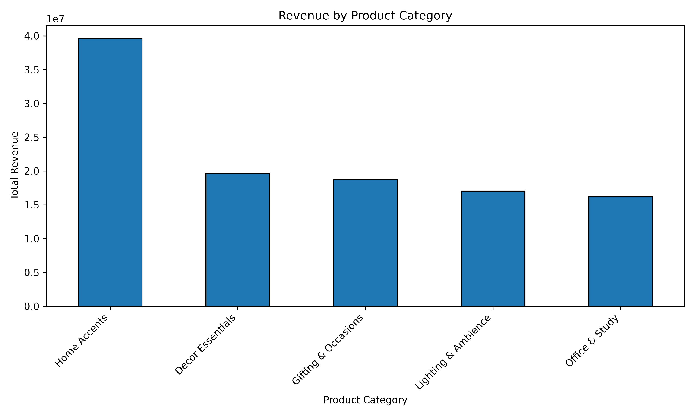
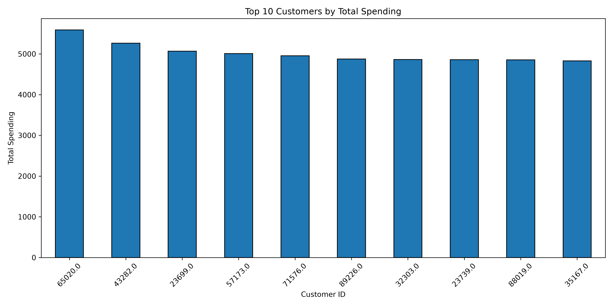

# Ecommerce-transaction-data-analysis-using-python

## Project Overview

This project explores an Ecommerce transaction dataset to understand sales patterns, transaction value distribution, category-level revenue, and customer-level spending.

Using Python, Pandas, and Matplotlib, I performed data inspection, data cleaning, transaction-level calculations, and exploratory data analysis to transform raw retail records into meaningful visual insights.

## Objectives

- Inspect and understand the structure of Ecommerce transaction data.
- Identify missing values, duplicate records, and cancellation transactions.
- Clean the dataset and prepare valid sales records for analysis.
- Calculate transaction amounts using price and quantity.
- Visualize transaction value distribution and sales trends over time.
- Compare revenue across product categories.
- Identify the top 10 customers by total spending.

## Tools & Technologies

- Python
- Pandas
- Matplotlib
- Jupyter Notebook / Python script environment

## Data Preparation

- Inspected dataset dimensions, column types, missing values, and duplicates.
- Identified cancellation transactions using transaction identifiers.
- Created a transaction amount field using Price × Quantity.
- Excluded cancellation transactions and records with non-positive quantity or price from the valid sales analysis.

## Key Analysis

### 1. Transaction Amount Distribution
Examined the distribution of transaction amounts and compared the mean and median to understand spending patterns.

### 2. Sales Trend Over Time
Aggregated transaction amounts by date to explore changes in sales over time.

### 3. Revenue by Product Category
Compared total transaction amounts across product categories.

### 4. Top 10 Customers
Ranked customers by total spending to identify high-value customers in the analyzed dataset.

## Visualizations

### Transaction Amount Distribution

### Transaction Amount Over Time

### Revenue by Category

### Top 10 Customers

## Results

- Original dataset: 500,000 records.
- Cancellation transactions identified: 14,995.
- Valid sales records after filtering: 485,005.
- Calculated transaction amount as Price × Quantity.
- Created four visualizations to examine transaction values, daily sales, category revenue, and customer spending.

## Skills Demonstrated

Python, Pandas, Data Cleaning, Exploratory Data Analysis (EDA), Data Visualization, Data Aggregation, and Analytical Thinking.

## Conclusion

This project demonstrates an end-to-end exploratory data analysis workflow, from inspecting and cleaning raw retail records to generating visual insights into sales and customer spending.

The analysis provides a foundation for further investigation into sales performance, customer segmentation, and ecommerce business trends.
